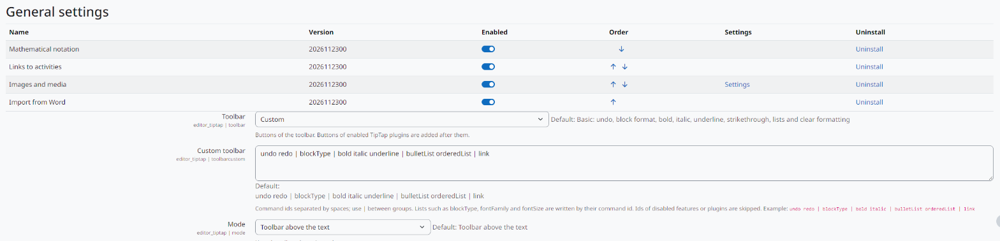

Configuration
=============

Enabling the editor
-------------------

1. Go to **Site administration > Plugins > Text editors > Manage editors**.
2. Enable **TipTap editor** (eye icon).
3. Move it to the top of the list with the arrows to make it the default editor of the site.

Editor settings
---------------

Go to **Site administration > Plugins > Text editors > TipTap editor > General settings**.

   TipTap plugins on top, then the toolbar, the mode and the features.

TipTap plugins
   Table of the installed TipTap plugins. Enable or disable each one with the switch, change the order with the arrows
   (the order of their buttons in the toolbar), open their settings or uninstall them. See :doc:`plugins`.

Toolbar
   **Minimal** (bold, italic, underline, strikethrough), **Basic** (undo, block format, bold, italic, underline,
   strikethrough, lists, clear formatting), **Full** (every feature) or **Custom**. Buttons of enabled TipTap plugins are
   added after them.

Custom toolbar
   Shown when the toolbar is **Custom**. Command ids separated by spaces, with ``|`` between groups. Lists are written by
   their command id (``blockType``, ``fontFamily``, ``fontSize``, ``textColor``, ``highlight``, ``lineHeight``...). Ids
   of disabled features or plugins are skipped. Example::

      undo redo | blockType | bold italic underline | bulletList orderedList | link | insertTable

   The command ids are listed in the
   `documentation of tiptap-core <https://tiptap-by-kelsoncm.github.io/tiptap-core/docs/comandos-e-barra.html>`_.

Mode
   **Toolbar above the text**, **Balloon** (formatting over the selected text) or **Blocks** (no toolbar; type ``/`` in
   an empty line to insert a block).

Features
   Features of the editor. A feature that is off is removed from the toolbar and the menus, and its content is not
   accepted when pasted. **Table of contents** is off by default.

Status bar
   Word and character counts below the text.

Capabilities
------------

Each TipTap plugin has a capability ``tiptap/<name>:use`` (for example ``tiptap/media:use``), allowed for the
authenticated user role by default. Remove it from a role or in a context to hide the plugin there.
