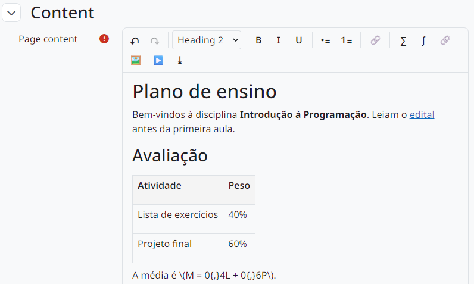

Overview - moodle-editor_tiptap
===============================

**moodle-editor_tiptap** (component ``editor_tiptap``) is a WYSIWYG text editor for Moodle built on
`@kelsoncm/tiptap-core <https://kelsoncm.github.io/tiptap-core/>`_ (Tiptap 3). It replaces the text area of HTML fields,
saves plain HTML like the other Moodle editors, and lets the administrator choose its toolbar, its features and extra
features installed as **TipTap plugins** (subplugins ``tiptap_*``).

Supports Moodle 4.5 LTS and 5.3 LTS.

   The editor in a page form, with buttons of the bundled TipTap plugins at the end of the toolbar.

Key features
------------

- **Toolbar**: the administrator chooses a preset (minimal, basic or full) or writes a custom toolbar with command ids.
- **Features**: tables, fonts, colours, line height, indentation, list styles, task lists, page breaks and more; each one
  can be turned off.
- **Modes**: toolbar above the text, balloon over the selection, or blocks (type ``/`` to insert a block).
- **TipTap plugins**: extra features as subplugins that the administrator enables, disables and orders on the settings
  page. Three come with the editor:

  - **Images and media**: images, video and audio from the Moodle file picker; uploads (button, paste or drop) go to the
    draft area of the field.
  - **Links to activities**: link the selected text to an activity or resource of the course.
  - **Mathematical notation**: equations written as TeX between ``\(`` ``\)`` or ``$$`` ``$$``, shown by the Moodle filters
    (MathJax or TeX notation).

- **Moodle strings**: every text of the interface is a Moodle language string, translated through AMOS.
- **Theme colours**: the editor follows the Bootstrap colours of the theme, including the Boost colour modes.
- **Privacy**: the editor and its plugins store no personal data.

Documentation
-------------

.. toctree::
   :maxdepth: 2
   :caption: Contents:

   installation
   configuration
   usage
   plugins
