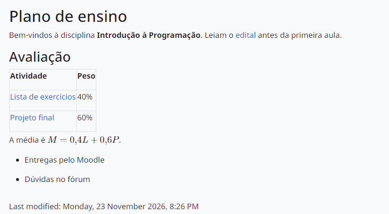
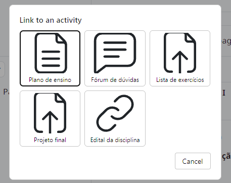

Usage
=====

Choosing the editor
-------------------

When the TipTap editor is not the default editor of the site, each user can choose it:

1. Open **Preferences > Editor preferences**.
2. Select **TipTap editor** and save.

Editing text
------------

Every HTML text field of Moodle forms (forum posts, descriptions, pages...) opens with the editor.

- Use the toolbar, or keyboard shortcuts such as **Ctrl+B** (bold), **Ctrl+I** (italic) and **Ctrl+K** (link).
- Markdown shortcuts work while typing: ``##`` and a space start a heading, ``-`` and a space a list.
- In the **Blocks** mode, type ``/`` in an empty line to choose a block.
- Text pasted from Word or Google Docs is cleaned; **Ctrl+Shift+V** pastes plain text.

The text is saved when the form is submitted. Opening and saving a form without changing the text keeps it as stored.

Images and files
----------------

With the **Images and media** plugin, in fields that accept files:

- the image and video buttons open the Moodle file picker (upload, server files, recent files, repositories);
- pasting or dropping an image uploads it to the draft area of the field. Moodle keeps it with the text when the form is
  saved.

Equations
---------

With the **Mathematical notation** plugin, the equation buttons ask for TeX (for example ``\frac{a}{b}``) and insert it
between ``\(`` and ``\)`` (inline) or ``$$`` and ``$$`` (display). The equation is shown by the MathJax or TeX notation
filter when the text is displayed:

   The saved text displayed in Moodle; the equation is rendered by the MathJax filter.

Links to activities
-------------------

With the **Links to activities** plugin, select some text (or leave the cursor where the link goes), click
**Link to an activity** and choose an activity or resource of the course:

   Activities and resources of the course that the user can see.
