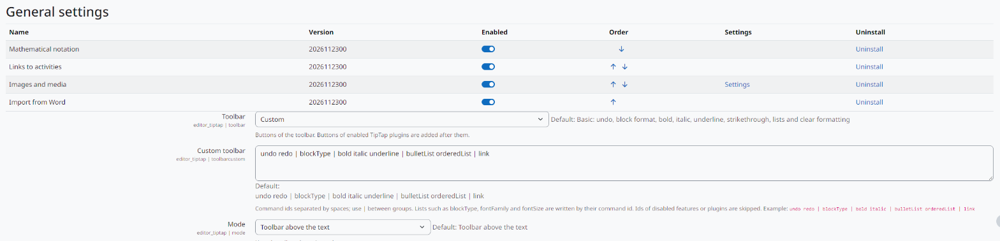

Configuração
============

Habilitando o editor
--------------------

1. Acesse **Administração do site > Plugins > Editores de texto > Gerenciar editores**.
2. Habilite o **TipTap editor** (ícone de olho).
3. Mova-o para o topo da lista com as setas para torná-lo o editor padrão do site.

Configurações do editor
-----------------------

Acesse **Administração do site > Plugins > Editores de texto > TipTap editor > Configurações gerais**.

   Plugins do TipTap no topo; depois a barra, o modo e os recursos.

Plugins do TipTap
   Tabela dos plugins do TipTap instalados. Habilite ou desabilite cada um no botão, mude a ordem com as setas (a ordem
   dos botões deles na barra), abra as configurações ou desinstale. Veja :doc:`plugins`.

Barra
   **Mínima** (negrito, itálico, sublinhado, tachado), **Básica** (desfazer, formato de bloco, negrito, itálico,
   sublinhado, tachado, listas, limpar formatação), **Completa** (todos os recursos) ou **Personalizada**. Os botões dos
   plugins do TipTap habilitados vêm depois.

Barra personalizada
   Aparece quando a barra é **Personalizada**. Ids dos comandos separados por espaço, com ``|`` entre os grupos. Listas
   são escritas pelo id do comando (``blockType``, ``fontFamily``, ``fontSize``, ``textColor``, ``highlight``,
   ``lineHeight``...). Ids de recursos ou plugins desabilitados são ignorados. Exemplo::

      undo redo | blockType | bold italic underline | bulletList orderedList | link | insertTable

   Os ids dos comandos estão na
   `documentação do tiptap-core <https://kelsoncm.github.io/tiptap-core/docs/comandos-e-barra.html>`_.

Modo
   **Barra acima do texto**, **Balão** (formatação sobre o texto selecionado) ou **Blocos** (sem barra; digite ``/``
   numa linha vazia para inserir um bloco).

Recursos
   Recursos do editor. Um recurso desligado sai da barra e dos menus, e seu conteúdo não é aceito ao colar. **Sumário**
   vem desligado.

Barra de status
   Contagem de palavras e caracteres abaixo do texto.

Permissões
----------

Cada plugin do TipTap tem a permissão ``tiptap/<nome>:use`` (por exemplo ``tiptap/media:use``), permitida para o papel de
usuário autenticado por padrão. Retire-a de um papel ou num contexto para esconder o plugin ali.
