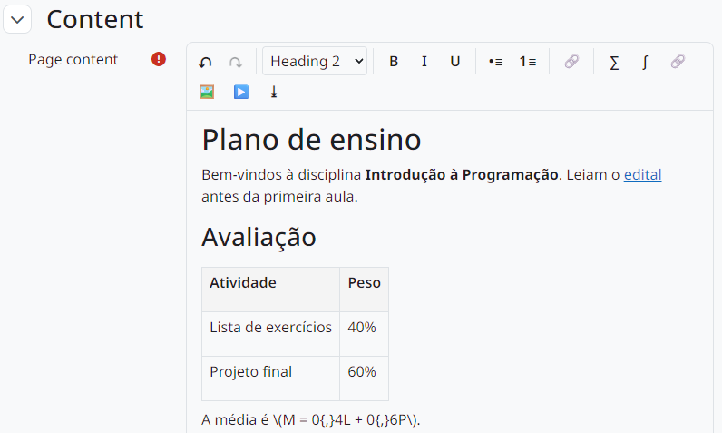

Visão geral - moodle-editor_tiptap
==================================

O **moodle-editor_tiptap** (componente ``editor_tiptap``) é um editor de texto WYSIWYG para o Moodle construído sobre o
`@kelsoncm/tiptap-core <https://kelsoncm.github.io/tiptap-core/>`_ (Tiptap 3). Ele substitui a área de texto dos campos HTML,
salva HTML simples como os demais editores do Moodle e permite ao administrador escolher a barra, os recursos e recursos
extras instalados como **plugins do TipTap** (subplugins ``tiptap_*``).

Compatível com o Moodle 4.5 LTS e 5.3 LTS.

   O editor no formulário de uma página, com os botões dos plugins do TipTap incluídos no fim da barra.

Recursos principais
-------------------

- **Barra**: o administrador escolhe um modelo (mínima, básica ou completa) ou escreve uma barra personalizada com os ids
  dos comandos.
- **Recursos**: tabelas, fontes, cores, entrelinha, recuo, estilos de lista, listas de tarefas, quebra de página e outros;
  cada um pode ser desligado.
- **Modos**: barra acima do texto, balão sobre a seleção ou blocos (digite ``/`` para inserir um bloco).
- **Plugins do TipTap**: recursos extras como subplugins que o administrador habilita, desabilita e ordena na página de
  configurações. Três vêm com o editor:

  - **Imagens e mídia**: imagens, vídeo e áudio pelo seletor de arquivos do Moodle; envios (botão, colar ou arrastar)
    vão para a área de rascunho do campo.
  - **Links para atividades**: liga o texto selecionado a uma atividade ou recurso do curso.
  - **Notação matemática**: fórmulas em TeX entre ``\(`` ``\)`` ou ``$$`` ``$$``, exibidas pelos filtros do Moodle
    (MathJax ou notação TeX).

- **Textos do Moodle**: todos os textos da interface são strings de idioma do Moodle, traduzidas pelo AMOS.
- **Cores do tema**: o editor segue as cores Bootstrap do tema, inclusive os modos de cor do Boost.
- **Privacidade**: o editor e seus plugins não armazenam dados pessoais.

Documentação
------------

.. toctree::
   :maxdepth: 2
   :caption: Conteúdo:

   installation
   configuration
   usage
   plugins
