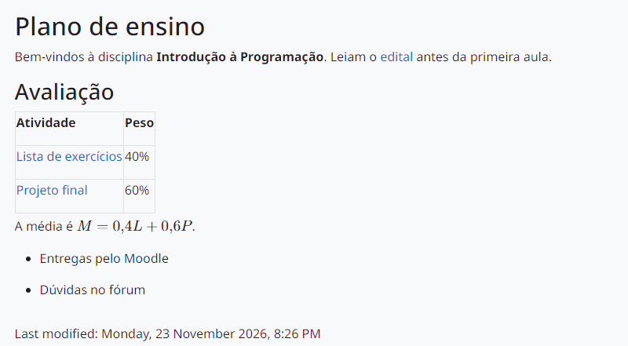
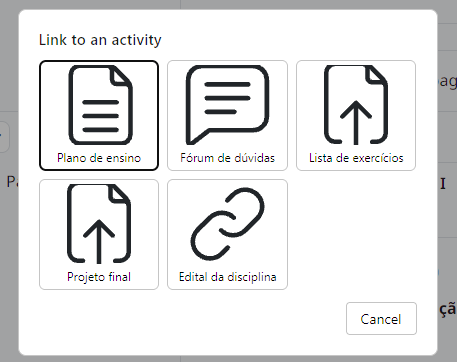

Uso
===

Escolhendo o editor
-------------------

Quando o TipTap editor não é o editor padrão do site, cada usuário pode escolhê-lo:

1. Abra **Preferências > Preferências do editor**.
2. Selecione **TipTap editor** e salve.

Editando texto
--------------

Todos os campos de texto HTML dos formulários do Moodle (mensagens de fórum, descrições, páginas...) abrem com o editor.

- Use a barra ou atalhos como **Ctrl+B** (negrito), **Ctrl+I** (itálico) e **Ctrl+K** (link).
- Atalhos de Markdown funcionam ao digitar: ``##`` e espaço começam um título, ``-`` e espaço uma lista.
- No modo **Blocos**, digite ``/`` numa linha vazia para escolher um bloco.
- Texto colado do Word ou do Google Docs é limpo; **Ctrl+Shift+V** cola texto simples.

O texto é salvo quando o formulário é enviado. Abrir e salvar um formulário sem mudar o texto o mantém como está gravado.

Imagens e arquivos
------------------

Com o plugin **Imagens e mídia**, em campos que aceitam arquivos:

- os botões de imagem e de vídeo abrem o seletor de arquivos do Moodle (enviar, arquivos do servidor, recentes,
  repositórios);
- colar ou arrastar uma imagem a envia para a área de rascunho do campo. O Moodle a guarda com o texto quando o formulário
  é salvo.

Fórmulas
--------

Com o plugin **Notação matemática**, os botões de fórmula pedem o TeX (por exemplo ``\frac{a}{b}``) e o inserem entre
``\(`` e ``\)`` (na linha) ou ``$$`` e ``$$`` (destacada). A fórmula é exibida pelo filtro MathJax ou notação TeX quando o
texto é mostrado:

   O texto salvo exibido no Moodle; a fórmula é renderizada pelo filtro MathJax.

Links para atividades
---------------------

Com o plugin **Links para atividades**, selecione um trecho (ou deixe o cursor onde vai o link), clique em
**Link to an activity** e escolha uma atividade ou recurso do curso:

   Atividades e recursos do curso que o usuário pode ver.
